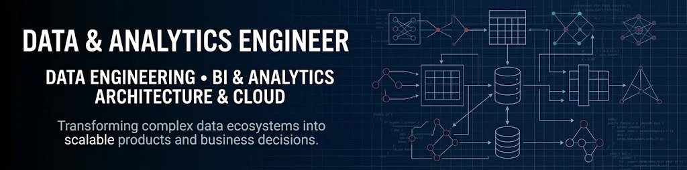
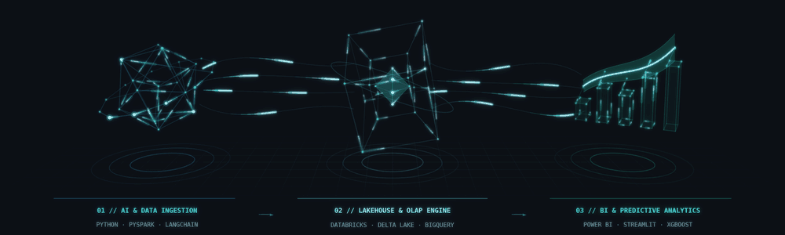

### 💫 **About Me**

I bridge the gap between traditional Business Intelligence and modern, AI-driven data architectures to build scalable data products.

- 🧠 **Focus:** Designing robust ETL pipelines, deploying predictive analytics apps, and automating enterprise reporting.
- ⚙️ **Impact:** Proven track record of reducing manual data errors by up to **60%** and improving analytical response times by **50%** in corporate environments through automated ETL workflows, SQL optimization, and data quality controls.
- 🎓 **Background:** Computer Engineer (UADE) with advanced certifications in Data Governance, Quality, and Analytics.

---

### 🚀 **Live Portfolio & Apps**

  
  

| Solution | Focus & Stack | Links |
| :--- | :--- | :--- |
| 🤖 **Sales AI Chatbot** | Text-to-SQL & visual analytics (`LangChain`, `BigQuery`, `Docker`, `GCP`, `Streamlit`) | [Live App](https://jml-ventas-ai.streamlit.app/) · [Code](https://github.com/jlandaa/Sales-AI-Chatbot) |
| 📈 **ADR Dashboard** | Argentine market ETL & financial analysis (`Python`, `SQLAlchemy`, `Plotly`, `Streamlit`) | [Live App](https://jml-dashboard-adr.streamlit.app/) · [Code](https://github.com/jlandaa/ETL_ADR_Argentina) |
| 💳 **Smart Credit ML** | Explainable credit risk model (`XGBoost`, `SHAP`, `BigQuery`, `Streamlit`) | [Live App](https://jml-smartcredit-ml.streamlit.app/) · [Code](https://github.com/jlandaa/Smart-Credit-ML) |
| 🛒 **Retail Price Scraper** | Automated competitive pricing ETL (`Databricks`, `PySpark`, `Delta Lake`, `Power BI`) | [Dashboard](https://app.powerbi.com/view?r=eyJrIjoiYzFhNWJmMzQtNTllYS00ODNkLTlkOTYtMDQyNmMzNzRiYjQ4IiwidCI6IjZjYmMyOTllLWIxZDUtNDJjZi1hMWRjLTgwNjZmMTdiN2QwNyIsImMiOjR9) · [Code](https://github.com/jlandaa/Retail-Price-Scraper) |
| ⚙️ **Portfolio Monitor** | Serverless DataOps & CI/CD automation (`GitHub Actions`, `Python`, `Selenium`) | [Actions](https://github.com/jlandaa/Portfolio-Monitor/actions) · [Code](https://github.com/jlandaa/Portfolio-Monitor) |

---

### 🏆 **Certifications & Data Governance**

-  &nbsp;**Project Architect, Administrator, Database Administrator, and ONE Professional.**
-  &nbsp;**Professional - Consultant & Seller.**
-  &nbsp;**Cloud Fundamentals.**

---

### 🏗️ **Data & AI Architecture**

---

### 🛠️ **Tech Stack & Tools**

**Data Engineering, ETL & Orchestration**

    

**Business Intelligence & Analytics**

    

**Databases & Cloud**

    

**Programming, AI & Data Science**

     

**CI/CD & DevOps**

   

---

### ⚡ **Current Focus**

- 🎯 **Open to:** Full-time corporate roles as a **Data Engineer**, **Analytics Engineer**, or **BI Developer / Consultant**.
- 🚀 **Currently building:** End-to-end data products integrating Lakehouse ETL automation (`Databricks`, `PySpark` & `Delta Lake`) with enterprise BI platforms, alongside interactive `Streamlit` & AI applications powered by real-world market datasets (finance, retail intelligence & credit risk).

---

### 📊 **GitHub Activity**

  <picture>
    <source media="(prefers-color-scheme: dark)" srcset="https://github-readme-streak-stats-one-pi-50.vercel.app/?user=jlandaa&background=0D1117&ring=38BDF8&fire=38BDF8&currStreakNum=E2E8F0&sideNums=E2E8F0&currStreakLabel=38BDF8&sideLabels=94A3B8&dates=94A3B8&hide_border=true&v=104" />
    <source media="(prefers-color-scheme: light)" srcset="https://github-readme-streak-stats-one-pi-50.vercel.app/?user=jlandaa&background=FFFFFF&ring=0A66C2&fire=0A66C2&currStreakNum=0A192F&sideNums=0A192F&currStreakLabel=0A66C2&sideLabels=475569&dates=64748B&hide_border=true&v=104" />
    
  </picture>

 

  <picture>
    <source media="(prefers-color-scheme: dark)" srcset="https://github-readme-activity-graph-phi-ten.vercel.app/graph?username=jlandaa&bg_color=0D1117&color=94A3B8&line=38BDF8&point=E2E8F0&area=true&area_color=1E293B&hide_border=true&hide_title=true" />
    <source media="(prefers-color-scheme: light)" srcset="https://github-readme-activity-graph-phi-ten.vercel.app/graph?username=jlandaa&bg_color=FFFFFF&color=1E293B&line=0A66C2&point=0A192F&area=true&area_color=E2E8F0&hide_border=true&hide_title=true" />
    
  </picture>

